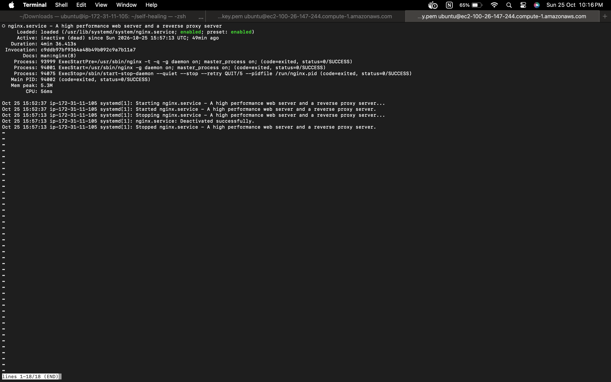
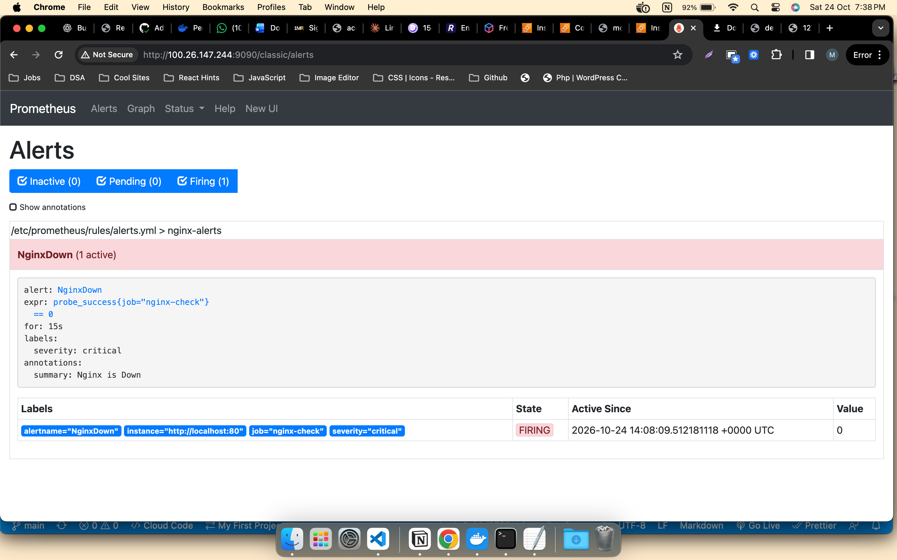
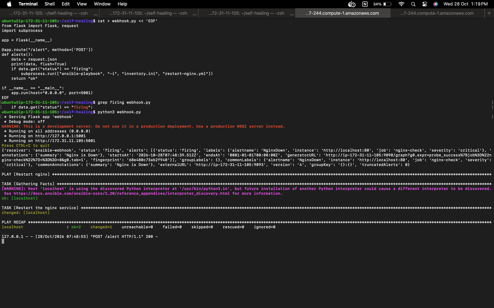
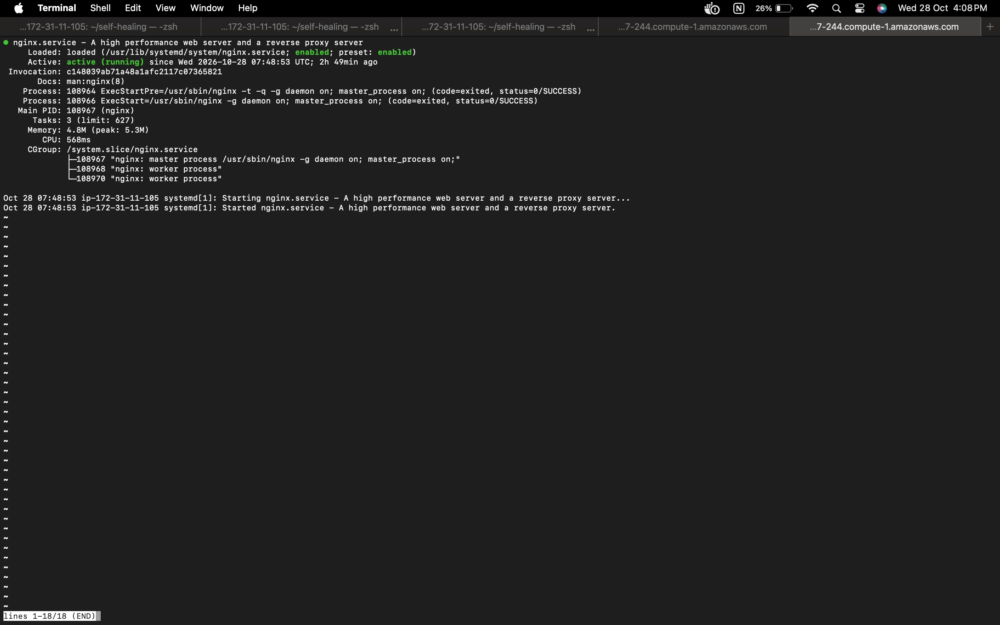

# Self-Healing Infrastructure with Prometheus, Alertmanager & Ansible

Automatically detect a service failure and recover it with no human action.
When the NGINX web server goes down, Prometheus detects it, Alertmanager sends an alert to a small webhook, and the webhook runs an Ansible playbook that restarts NGINX.

**Stack:** Ubuntu on AWS EC2, NGINX, Prometheus, Blackbox Exporter, Alertmanager, Ansible, Python (Flask)

## How it works

```
NGINX (80)
   ^  probed every 5s
Blackbox exporter (9115)  -->  Prometheus (9090)  -->  Alertmanager (9093)
                               rule: NginxDown          sends JSON to webhook
                                                                |
                                                                v
                                              webhook.py (5001, Flask)
                                                                |
                                                                v
                                       ansible-playbook restart-nginx.yml
                                                                |
                                                                v
                                                       NGINX restarted
```

1. **Detect:** Prometheus scrapes the blackbox exporter every 5 seconds. The exporter requests `http://localhost:80` and reports `probe_success` (1 = up, 0 = down).
2. **Alert:** the `NginxDown` rule fires when `probe_success == 0` has held for 15 seconds, so a one-second blip does not trigger a restart.
3. **Notify:** Alertmanager waits 10 seconds (`group_wait`), then sends a JSON message to `http://localhost:5001/alert`.
4. **Heal:** `webhook.py` runs the Ansible playbook only when the alert status is `firing`. The `resolved` message that follows is ignored.

Everything runs on one EC2 instance, so the components talk over `localhost`. Only the Prometheus UI port (9090) needs to be opened in the security group.

## Files

| File | Purpose |
|---|---|
| `prometheus.yml` | Prometheus config: scrape jobs, blackbox probe of NGINX, Alertmanager target |
| `alerts.yml` | Alert rule `NginxDown` (`probe_success == 0` for 15s) |
| `alertmanager.yml` | Routes alerts to the webhook, with the timing settings |
| `webhook.py` | Flask app that receives alerts and runs the playbook |
| `inventory.ini` | Ansible inventory (the local machine) |
| `restart-nginx.yml` | Ansible playbook that restarts NGINX |
| `screenshots/` | Demo evidence |

On the server, the Prometheus files live in `/etc/prometheus/` (`prometheus.yml`, `rules/alerts.yml`, `alertmanager.yml`). `webhook.py`, `inventory.ini` and `restart-nginx.yml` are kept in `~/self-healing`.

## Key configuration

**Alert rule (`alerts.yml`)**

```yaml
groups:
  - name: nginx-alerts
    rules:
      - alert: NginxDown
        expr: probe_success{job="nginx-check"} == 0
        for: 15s
        labels:
          severity: critical
        annotations:
          summary: "Nginx is Down"
```

**Alertmanager (`alertmanager.yml`)**

```yaml
route:
  receiver: ansible-webhook
  group_wait: 10s
  group_interval: 30s
  repeat_interval: 5m

receivers:
  - name: ansible-webhook
    webhook_configs:
      - url: http://localhost:5001/alert
```

**Webhook (`webhook.py`)**

```python
from flask import Flask, request
import subprocess

app = Flask(__name__)

@app.route("/alert", methods=['POST'])
def alerts():
    data = request.json
    print(data, flush=True)
    if data.get("status") == "firing":
        subprocess.run(["ansible-playbook", "-i", "inventory.ini", "restart-nginx.yml"])
    return "ok"

if __name__ == "__main__":
    app.run(host="0.0.0.0", port=5001)
```

**Playbook (`restart-nginx.yml`) and inventory (`inventory.ini`)**

```yaml
- name: Restart nginx
  hosts: local
  become: true
  tasks:
    - name: Restart the nginx service
      ansible.builtin.service:
        name: nginx
        state: restarted
```

```ini
[local]
localhost ansible_connection=local
```

## Run it

1. Make sure NGINX, Prometheus, the blackbox exporter and Alertmanager are running.
2. Start the webhook from the folder that contains the playbook and inventory (the file names are relative):

```bash
   cd ~/self-healing
   python3 webhook.py
```

3. Keep that terminal open. If the webhook is not running, alerts have nowhere to go and nothing is restarted.

## Test the self-healing

In a second terminal on the server:

```bash
sudo systemctl stop nginx; date
```

Then watch:

1. The Prometheus **Alerts** page (`http://<server-ip>:9090/alerts`): `NginxDown` goes Pending, then FIRING.
2. The webhook terminal: the alert (`'status': 'firing'`) and the Ansible output (`changed=1`, `failed=0`).
3. `sudo systemctl status nginx`: it shows `active (running)` again without any manual start.

## Demo

**Before: NGINX stopped**



**Detection: alert is firing in Prometheus**



**Healing: webhook receives the alert and runs Ansible**



**After: NGINX is running again**



## Problems faced and fixes

| Problem | Cause | Fix |
|---|---|---|
| Alert never reached Ansible | `webhook.py` only printed the alert | Added the `subprocess` call to run the playbook |
| Playbook or inventory not found | File name typos (`restart_nginx.yml`, `inventory-ini`) | Corrected to `restart-nginx.yml` and `inventory.ini` |
| Alert would not fire | Rule used `up`, which stays 1 because the exporter is still running | Changed to `probe_success == 0` |
| No delivery to the webhook | Alertmanager URL used port 5000, the webhook listens on 5001 | Corrected the URL to port 5001 |
| Healing stopped overnight | Webhook was not running (`connection refused` in the Alertmanager log) | Restarted it; running it as a service is listed below |
| Slow recovery (up to an hour) | Default Alertmanager timers after failed deliveries | Set `group_wait` 10s, `group_interval` 30s, `repeat_interval` 5m |
| Extra restart on recovery | Webhook also ran for `resolved` messages | Run Ansible only when the status is `firing` |

## Limitations and improvements

- The webhook stops when the SSH session closes. Run `webhook.py` as a systemd service so it survives logouts and reboots.
- Add a second rule, for example CPU above 90%.
- The webhook has no authentication. Add a shared secret or restrict access to localhost.
- Flask's built-in server is for development. Use a production WSGI server for anything real.
- If the whole instance goes down, nothing heals, because Prometheus, the webhook and Ansible all run on the same machine.
